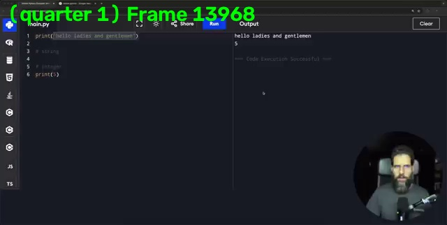
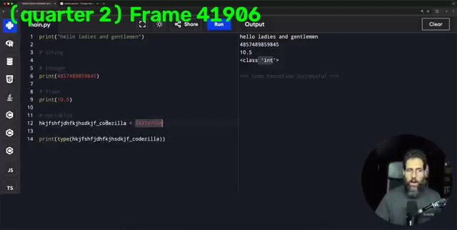
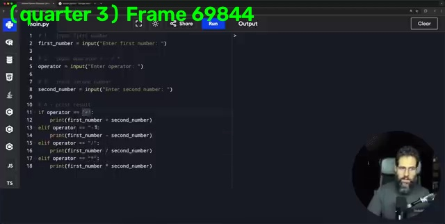
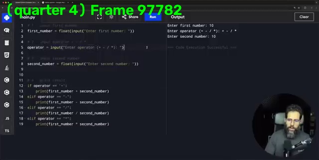

# Video Frame Extractor & Visualizer

A Python project using **OpenCV** and **Matplotlib** to extract, label, and visualize specific video frames at quarter intervals (12.5%, 37.5%, 62.5%, and 87.5% of total duration).

## Features
- Calculates video duration, FPS, and total frame count.
- Extracts target frames using precise index calculations.
- Overlays text (Frame number and Quarter label) using `cv2.putText`.
- Corrects color channels from BGR to RGB for accurate visualization.
- Displays all extracted frames side-by-side using Matplotlib subplots.

## Tech Stack
- Python
- OpenCV (`cv2`)
- Matplotlib

## Output Preview
| Quarter 1 | Quarter 2 | Quarter 3 | Quarter 4 |
|:---:|:---:|:---:|:---:|
|  |  |  |  |